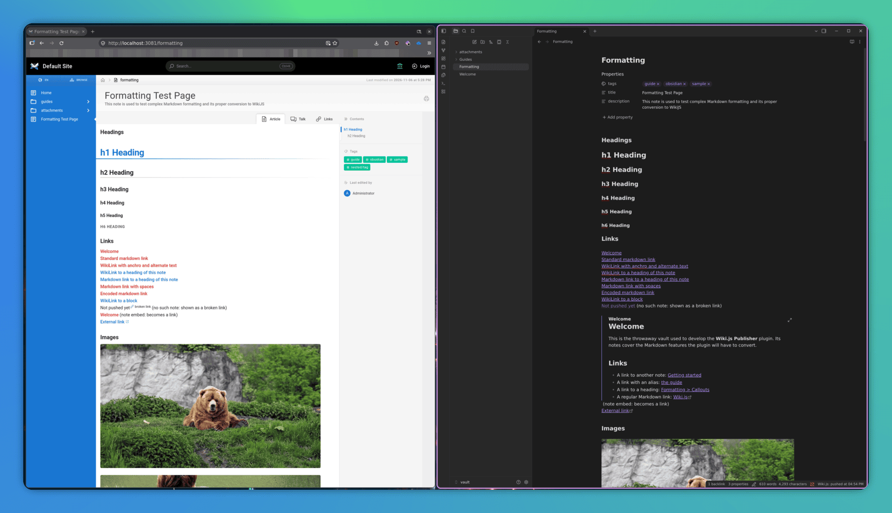
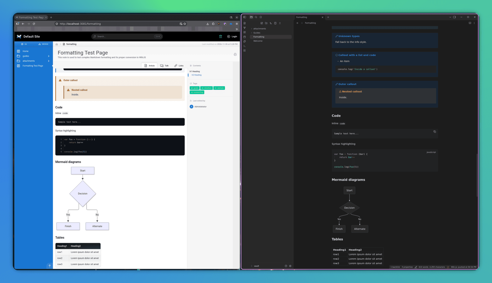
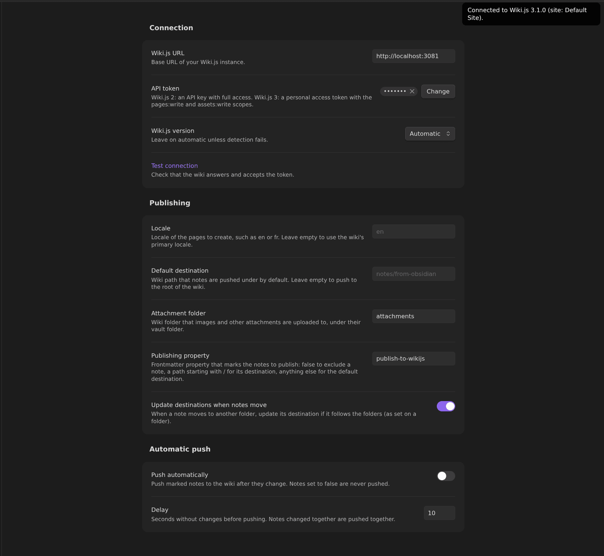
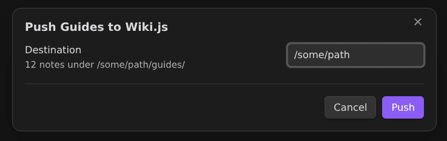
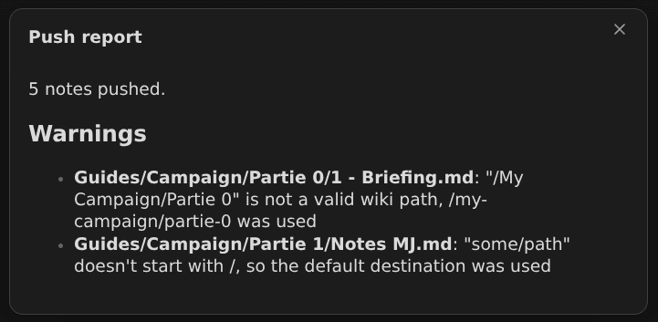
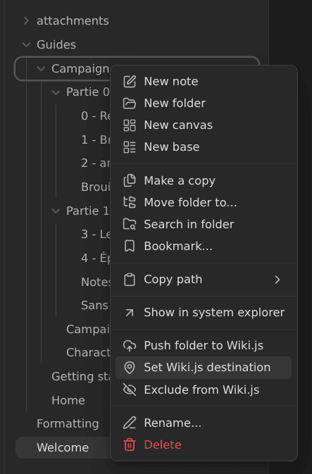
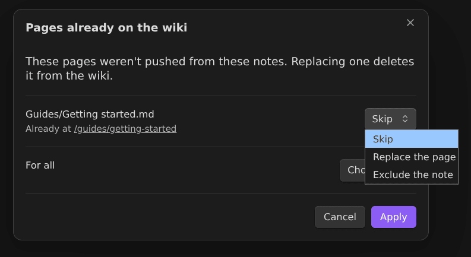

# Wiki.js Publisher

An [Obsidian](https://obsidian.md) plugin that publishes your notes to a [Wiki.js](https://js.wiki) instance. Write in Obsidian, push to the wiki: links, images, callouts, tags and math are converted to what Wiki.js understands.

> [!WARNING]
> **Alpha.** The plugin works and is tested against Wiki.js 2 and 3, but it hasn't seen much real-world use yet. Try it on a test wiki, or on a wiki you have a backup of, before trusting it with important pages.




## Features

- **Push a note, a folder, or every marked note** to the wiki, from the command palette or the file menu.
- **One-way:** Obsidian is the source. Pages are created or updated from your notes; nothing is ever pulled back.
- **Per-note destinations** stored in a frontmatter property, with tools to set them on whole folders and keep them right when notes move.
- **Automatic push** (opt-in) of marked notes after you edit them.
- **Conversion** of Obsidian syntax: wikilinks, embeds and attachments, callouts, highlights, tags, comments, math and Mermaid diagrams.
- **Safe overwrites:** a page is only replaced without asking if this plugin pushed it from the same note. Renamed or moved notes move their page instead of leaving a copy behind.
- **Wiki.js 2 and 3**, detected automatically.
- Made for desktop and mobile (not tested on mobile yet).

## Requirements

- Obsidian 1.14.4 or later.
- A Wiki.js 2.5 or Wiki.js 3 instance, and an account allowed to create API tokens on it.

## Installation

The plugin isn't in the community plugin catalog yet. Install it with [BRAT](https://github.com/TfTHacker/obsidian42-brat), which also keeps it up to date.

### With BRAT

1. In Obsidian, open **Settings → Community plugins**, select **Browse**, then search for and install **BRAT**. Enable it.
2. Open the command palette and run **BRAT: Plugins: Add a beta plugin for testing**.
3. Enter the repository URL: `https://github.com/snyssen/obsidian-wikijs-publisher`, then select **Add plugin**.
4. In **Settings → Community plugins**, enable **Wiki.js Publisher**.

BRAT checks for new releases when Obsidian starts, or when you run **BRAT: Check for updates to all beta plugins**.

### Manual installation

Download `main.js` and `manifest.json` from the [latest release](https://github.com/snyssen/obsidian-wikijs-publisher/releases/latest) and copy them to `<your vault>/.obsidian/plugins/wikijs-publisher/`. Reload Obsidian, then enable the plugin in **Settings → Community plugins**.

## Setup

### 1. Create an API token on the wiki

- **Wiki.js 2:** in **Administration → API Access**, enable the API if it's off, then select **New API Key** and give it **Full Access**.
- **Wiki.js 3:** in your profile, create a **personal access token** with the `pages:write` and `assets:write` scopes.

Copy the token: the wiki only shows it once.

### 2. Configure the plugin

Open **Settings → Wiki.js Publisher**.



| Setting | Description |
| --- | --- |
| **Wiki.js URL** | Base URL of the wiki, such as `https://wiki.example.com`. |
| **API token** | The token from step 1. It's kept in Obsidian's secret storage, not in the plugin's settings file. |
| **Wiki.js version** | Leave on **Automatic** unless detection fails. |
| **Test connection** | Checks that the wiki answers and accepts the token, and shows its version. |
| **Locale** | Locale of the pages to create, such as `en`. Leave empty for the wiki's primary locale. |
| **Default destination** | Wiki path that notes go under when no other destination is given. Empty means the root of the wiki. |
| **Attachment folder** | Wiki folder that images and other files are uploaded to (default `attachments`). |
| **Publishing property** | Frontmatter property that marks notes for publishing (default `publish-to-wikijs`). See [The publishing property](#the-publishing-property). |
| **Update destinations when notes move** | Keeps destinations in sync with your folders. See [Moving notes](#moving-notes). |
| **Push automatically** / **Delay** | See [Automatic push](#automatic-push). |

Select **Test connection** to check the setup.

## Usage

### Pushing notes

| What | How | Where the pages go |
| --- | --- | --- |
| **One note** | **Push current note** in the command palette, or **Push to Wiki.js** in the note's file menu | `<destination>/<note name>`. You're asked for the destination, prefilled with the note's own destination if it has one. |
| **A folder** | **Push folder to Wiki.js** in the folder's file menu | `<destination>/<folder path>/<note path>`: the vault's folders are kept. Notes set to `false` are left out. |
| **Every marked note** | **Push notes marked for publishing** in the command palette | Each note to its own destination (see below), after a confirmation. |



Paths are turned into valid wiki paths: lowercase, spaces become `-`, punctuation is dropped, accented letters are kept. `Events/Partie 0/2 - Arrivée à l'entrepôt.md` pushed to `campaign` becomes `/campaign/events/partie-0/2-arrivée-à-lentrepôt`.

The page title comes from the frontmatter `title` (or the file name), and the frontmatter `description` and `tags` are used too.

After a push, a notice links to the page. When several notes are pushed and something went wrong, a report lists what failed, what was skipped and any warnings, note by note.



### The publishing property

The publishing property (`publish-to-wikijs` by default) marks a note for publishing, and its value says where to:

| Value | Meaning |
| --- | --- |
| `/some/path` | The note's own destination: the page is `/some/path/<note name>`. `/` is the root of the wiki. |
| `true`, empty, or any other value | The **Default destination** setting. A value that doesn't start with `/` gets a warning, since it's probably a typo. |
| `false` | Excluded: never pushed with its folder, by **Push notes marked for publishing**, or automatically. |
| *(no property)* | Not marked: only pushed when you push the note or its folder. |

```yaml
---
publish-to-wikijs: /my-campaign/partie-0
---
```

A destination you type by hand that isn't a valid wiki path (`/My Campaign`) is fixed at push time (`/my-campaign`), with a warning naming the note.

You don't have to write these values yourself. The file menu of notes and folders, and the command palette for the current note, have:

- **Set Wiki.js destination:** on a note, writes its destination. On a folder, writes a destination to every note inside, followed by each note's subfolders: setting `Events` to `/campaign` gives `Events/Intro.md` the value `/campaign` and `Events/Partie 0/Briefing.md` the value `/campaign/partie-0`. Turn on **Only notes that already have the property** to leave unmarked notes alone. Notes set to `false` are never changed.
- **Exclude from Wiki.js:** sets the note, or every note of the folder, to `false`. Pages already on the wiki stay there.



### Moving notes

When a note moves to another folder and its destination follows the folders (as **Set Wiki.js destination** writes it), the destination is updated: moving a note from `Events/Partie 0` to `Events/Partie 1` turns `/campaign/partie-0` into `/campaign/partie-1`. Destinations that don't follow the folders are left as they are, and the notice says so. Turn this off with **Update destinations when notes move**.

When a pushed note ends up at a different wiki path (renamed, moved, or given a new destination), its next push **moves its page** instead of creating a second one. On Wiki.js 3, links to the page from other wiki pages are updated too.

### Existing pages

The plugin remembers which page each note was pushed to. It only updates a page without asking if that page came from the same note. If any other page is already at a note's path (created on the wiki, or pushed from another note), you're asked what to do, for all such pages of the push at once:

- **Skip:** don't push the note this time.
- **Replace the page:** delete the existing page, then push the note.
- **Exclude the note:** set the note to `false`.



### Automatic push

Turn on **Push automatically** to push marked notes after you edit them. Changes are gathered until nothing has changed for the **Delay** (10 seconds by default), then pushed together.

- Successful pushes are silent. On desktop, the status bar shows when the last push ran. Failures and warnings show one notice; run **Show last automatic push report** for the details.
- Notes set to `false` or without the property are never pushed automatically.
- If you chose **Skip** for a page already on the wiki, automatic push leaves that note alone afterwards instead of asking again. Push it manually to be asked again.
- When a note is published for the first time, the published notes that link to it are pushed again, so their links to it start working.
- If the wiki can't be reached, the notes wait for the next attempt, and the error is shown once. Notes waiting when Obsidian closes are pushed at the next start.

## What gets converted

| Obsidian | On the wiki |
| --- | --- |
| `[[Note]]`, `[[Note\|alias]]`, `[[Note#Heading]]`, `[Text](Note.md)` | Links to the note's page (and heading). A note that isn't published on this wiki becomes plain text with a ⛓️‍💥 *broken link* marker. |
| `![[Note]]` (note embed) | A link to the note's page. |
| `![[image.png]]`, `![[image.png\|300]]`, `[[file.pdf]]` | The file is uploaded under the attachment folder, keeping its vault folder, and linked or shown (with its size). |
| Callouts (`> [!warning] Title`) | Wiki.js callouts (info, success, important, warning, danger), title kept. |
| `#tags` in the text | Added to the page's tags, and linked to the wiki's tag search. |
| `==highlight==` | Highlighted text. |
| `%%comments%%`, block ids (`^abc123`) | Removed. |
| `$math$`, `$$math$$` | Rendered by KaTeX. |
| Mermaid code blocks | Rendered as diagrams. |

Code blocks and inline code are never changed. Headings, lists, tasks, tables, footnotes and the rest of standard Markdown are rendered by Wiki.js as they are.

### Known limitations

- Pushing a note doesn't update the pages that link to it, except with automatic push: push them again to fix their links.
- Deleting a note, or excluding it, doesn't delete its page from the wiki.
- Embedded notes are linked, not inlined.
- Edits made on the wiki are overwritten by the next push of the note.

## Network use and privacy

This plugin talks to **your Wiki.js instance only**, at the URL you configure. It has no telemetry and contacts no other service.

- **When:** when you push notes or test the connection, and, if you turn on **Push automatically**, after you edit marked notes.
- **What is sent:** the content of the notes you push (converted, without frontmatter or comments), their title, description and tags, and the attachments they link to or embed. The plugin also reads pages and the wiki's version to find out what already exists, and can move or delete pages as described in [Moving notes](#moving-notes) and [Existing pages](#existing-pages).
- **What is stored locally:** the API token in Obsidian's secret storage. The plugin's `data.json` keeps the settings and which vault note was pushed to which wiki path.

## Development

The development environment is handled by [Nix](https://nixos.org/) (loaded with [direnv](https://direnv.net/)), uses [Just](https://github.com/casey/just) as a task runner and [Pre-commit](https://pre-commit.com/) for checks on each commit. [ROADMAP.md](ROADMAP.md) tracks the development plan, the design decisions and the Wiki.js API notes.

### Prerequisites

- Nix with flakes enabled
- direnv
- Docker with the compose plugin (for the throwaway Wiki.js instances)

Everything else (Node.js, Obsidian, jq, ...) is provided by the Nix devshell.

### First start

```bash
direnv allow   # load the devshell
just setup     # install pre-commit hooks and npm dependencies, prepare the dev vault
```

Run `just` to list all available recipes.

### Throwaway Wiki.js instances

```bash
just wiki-up     # start Wiki.js v2 and v3 (each with its Postgres) and seed them
just wiki-reset  # start over from fresh instances
just wiki-down   # stop them (data is kept)
```

| | URL | API token | API reference |
| --- | --- | --- | --- |
| Wiki.js v2 | <http://localhost:3080> | `dev/wikijs/.api-key-v2` (admin API key) | GraphQL, introspection at `/graphql` |
| Wiki.js v3 | <http://localhost:3081> | `dev/wikijs/.api-key-v3` (personal access token, `pages:write` + `assets:write`) | REST, Swagger UI at `/_api/` |

Set `WIKI_V2_PORT`/`WIKI_V2_URL` or `WIKI_V3_PORT`/`WIKI_V3_URL` to change the ports. Seeding is idempotent and, on each instance:

- sets up the `admin@example.com` / `admin12345` admin account,
- enables the API and creates the API token,
- on v3, makes the wiki publicly readable (a fresh v3 install is private, unlike v2),
- creates a few sample pages.

### Throwaway Obsidian instance

```bash
just obsidian  # launch Obsidian on the dev vault
just dev       # build the plugin in watch mode, straight into the dev vault
```

`just obsidian` launches Obsidian with its configuration stored in `dev/obsidian-config/` instead of `~/.config/obsidian`, so it is fully isolated from your main installation (it can even run alongside it). It opens the sample vault in `dev/vault/`, which comes with the [Hot Reload](https://github.com/pjeby/hot-reload) plugin: the plugin is reloaded automatically each time `just dev` rebuilds it.

On first launch, Obsidian asks whether you trust the vault's author: select **Trust author and enable plugins**. This choice is kept in `dev/obsidian-config/`; run `just obsidian-reset` to start over.

### Tests

```bash
just test              # unit tests
just test-integration  # against the throwaway Wiki.js instances (run `just wiki-up` first)
```

### Releasing

Releases are automated with [Release Please](https://github.com/googleapis/release-please), from [Conventional Commits](https://www.conventionalcommits.org/) on `master`:

1. The **Build & Release** workflow keeps a release PR open, with the next version (in `package.json`, `package-lock.json` and `manifest.json`) and the changelog.
2. Merging it tags the release (`0.3.0`, no leading `v`, as Obsidian requires) and creates the GitHub release. The same run builds the plugin with Nix (`nix build .#wikijs-publisher`, which also type-checks, lints and runs the unit tests), attaches `main.js` and `manifest.json` to the release and attests their provenance.

`versions.json` only needs an entry when `minAppVersion` changes: map the version that raises it to the new minimum.

## License

[MIT](LICENSE)
