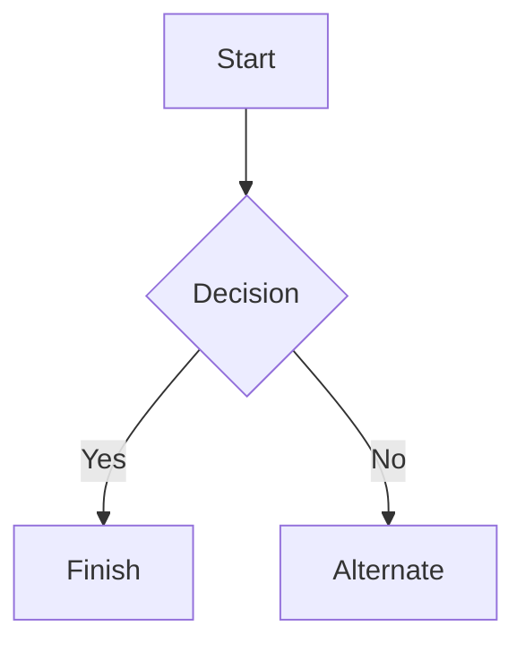

---
tags:
  - guide
  - obsidian
  - sample
title: Formatting Test Page
description: This note is used to test complex Markdown formatting and its proper conversion to WikiJS
---
### Headings

# h1 Heading

## h2 Heading

### h3 Heading

#### h4 Heading

##### h5 Heading

###### h6 Heading

### Links

[[Welcome]]
[Standard markdown link](./Welcome.md)
[[Welcome#Links|WikiLink with anchro and alternate text]]
[[#Tables|WikiLink to a heading of this note]]
[Markdown link to a heading of this note](#Code)
[Markdown link with spaces](<Guides/Getting started.md>)
[Encoded markdown link](Guides/Getting%20started.md)
[[Formatting#^block-ref|WikiLink to a block]]
[[Not pushed yet]] (no such note: becomes plain text)
![[Welcome]] (note embed: becomes a link)
[External link](https://js.wiki)

### Images

![[bear1.jpg]]

![[diagram.svg]]
![[bear1.jpg|200]]

### Lists

#### Unordered

-   Lorem ipsum dolor sit amet
-   Lorem ipsum dolor sit amet
    -   Lorem ipsum dolor sit amet
        -   Lorem ipsum dolor sit amet
        -   Lorem ipsum dolor sit amet
        -   Lorem ipsum dolor sit amet
-   Lorem ipsum dolor sit amet

#### Ordered

1. Lorem ipsum dolor sit amet
2. Lorem ipsum dolor sit amet
3. Lorem ipsum dolor sit amet

Start numbering with offset:

57. Lorem ipsum dolor sit amet
58. Lorem ipsum dolor sit amet

#### Checkboxes

-   [ ] Lorem ipsum dolor sit amet
-   [x] Lorem ipsum dolor sit amet
-   [ ] Lorem ipsum dolor sit amet

### Emphasis

**Bold text**

_Italic text_

~~Strikethrough~~

### Horizontal Rule

---

### Blockquotes

> Blockquotes
>
> > Nested blockquotes
> >
> > > Nested blockquotes

### Callouts

> [!note]
> A note callout.

> [!warning] Custom title
> A warning callout with a custom title.

> [!tip]- Foldable tip
> Folded by default in Obsidian, always open on the wiki.

> [!success]
> Green, like tips.

> [!question] Questions use the warning style
> Like `faq` and `help`.

> [!bug]
> Red, like `danger`, `error` and `failure`.

> [!important]
> Its own style on v3, info on v2.

> [!custom-type] Unknown types
> Fall back to the info style.

> [!info] Callout with a list and code
> - An item
> ```js
> console.log('Inside a callout')
> ```

> [!note] Outer callout
> > [!warning] Nested callout
> > Inside.

### Code

Inline `code`

```
Sample text here...
```

Syntax highlighting

```js
var foo = function (bar) {
    return bar++
}

console.log(foo(5))
```

### Mermaid diagrams


### Tables

| Heading1 | Heading2                   |
| -------- | -------------------------- |
| row1     | Lorem ipsum dolor sit amet |
| row2     | Lorem ipsum dolor sit amet |
| row3     | Lorem ipsum dolor sit amet |

Right aligned columns

| Heading1 |                   Heading2 |
| -------: | -------------------------: |
|     row1 | Lorem ipsum dolor sit amet |
|     row2 | Lorem ipsum dolor sit amet |
|     row3 | Lorem ipsum dolor sit amet |

Links in tables escape the alias pipe:

| Page                         |
| ---------------------------- |
| [[Welcome\|Welcome, aliased]] |

### Obsidian syntax

==Highlighted text== and **==bold highlight==**

Inline tags: #sample and #nested/tag (an issue number like #123 is not a tag)

A comment %%hidden on the wiki%% inside a sentence.

%%
A comment block, hidden on the wiki.
%%

A paragraph with a block id, which a link above points to. ^block-ref

Code is left alone: `[[Welcome]] #not-a-tag ==not highlighted==`

### Math

Inline math $e^{i\pi} + 1 = 0$, while prices are not math: $5 and $10.

$$
\int_0^1 x\,dx = \frac{1}{2}
$$

### Footnotes

Text with a footnote[^1].

[^1]: The footnote.

### HTML

<!-- An HTML comment: hidden in Obsidian and on the wiki -->

This is inline <span style="color: red;">html</span>

<audio controls>
    <source src="https://archive.org/download/OTRR_Dimension_X_Singles/Dimension_X_1950-04-08__01_OuterLimit.mp3" />
    Your browser does not support the audio element.
</audio>

<video controls>
    <source src="https://upload.wikimedia.org/wikipedia/commons/transcoded/a/a4/Mickey_Mouse_The_Barn_Dance_1929.webm/Mickey_Mouse_The_Barn_Dance_1929.webm.240p.vp9.webm"  />
    Your browser does not support the video element.
</video>

### XSS Attack

<script>alert('XSS Atack. When you see this you should use sanitizer.')</script>
